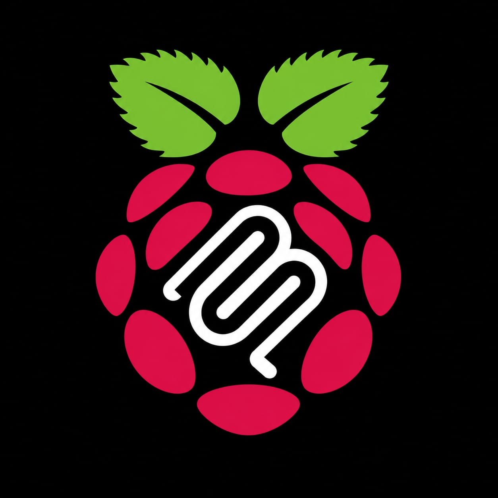

# Raspberry MCP

<p align="center">
  
</p>

MCP server for securely monitoring and controlling a Raspberry Pi from an
Agent. It uses Streamable HTTP and requires a bearer token for every HTTP
request.

## Current status

The MVP is operational and the main workflows are implemented:

- Authenticated diagnostics for host metrics, storage, service discovery,
  status, logs and resource usage.
- Guarded `start`, `stop` and `restart` actions with explicit service
  allowlists, safe no-ops and post-action state verification.
- ARM64 image builds and deployment to development, with manual production
  promotion and rollback by immutable image digest.
- Remote Agent access through an authenticated SSH local tunnel. The MCP stays
  on Raspberry loopback and is not published directly to the LAN or Internet.
- Reproducible validation of authentication, MCP protocol behavior, service
  errors, canary recovery and idempotence. See the [EVA-01 evaluation](docs/eva-01-evaluation.md)
  and its [execution results](docs/eva-01-results-2026-11-25.md).

The automated test suite is run in CI and covers authentication, diagnostics,
Docker-backed service operations, deployment safety, Raspberry discovery and
remote tunneling.

## Development and production deployments

Work in feature branches and merge PRs into `main`. GitHub Actions builds an
ARM64 image and deploys it to the dev environment. A separate manual workflow
promotes an exact previously tested image digest to production, with deployment
history and rollback. Neither deployment modifies your source checkout.

See [deployment setup and operations](docs/deployments.md) for runner setup,
first-time activation, promotion and checking the currently running version.
See [the diagnostic contract and Pi verification guide](docs/diagnostics.md)
for the read-only MCP tools, response shapes, limits, and the MVP acceptance
checklist.
See [the remote Agent access runbook](docs/remote-access.md) for the supported
same-network transport, host identity verification, IP changes and failure
handling, including limited Raspberry discovery and explicit pairing.
See [the CYE-02 Raspberry validation evidence](docs/cye-02-validation.md) for
the latest live deployment check and the lifecycle-control safety block.

See [the EVA-01 evaluation](docs/eva-01-evaluation.md) for the incident catalog,
comparison method and limitations, and [the recorded execution results](docs/eva-01-results-2026-11-25.md)
for the canary measurements.

## Run locally

Generate a long random token and provide it through the private runtime
environment. The server rejects missing, blank, whitespace-containing, short,
or obviously repetitive values. Keep the token out of the repository and do
not paste it into logs or chat:

```sh
export RASPBERRY_MCP_TOKEN="$(python -c 'import secrets; print(secrets.token_urlsafe(32))')"
uv run raspberry-mcp
```

The server listens at `http://127.0.0.1:8000/mcp` by default. It exits with a
generic configuration error if `RASPBERRY_MCP_TOKEN` is missing or weak;
neither the token nor its value is included in that error. Requests without a
matching `Authorization: Bearer <token>` header receive HTTP 401 without
echoing credentials.

For remote Agent access, use the documented SSH local-forward procedure rather
than publishing the MCP port. The default listener remains on loopback; only
change `RASPBERRY_MCP_HOST` for a separately reviewed deployment design.

## Connect Codex

Configure Codex's HTTP MCP server URL as `http://127.0.0.1:8000/mcp` when
Codex runs on the Pi. For a client on another device, first start the SSH
tunnel from [the remote access runbook](docs/remote-access.md), then use the
local forwarded URL below. In Codex's local `config.toml`, use its environment
variable option so the token itself is not stored in the file:

```toml
[mcp_servers.raspberry_pi]
url = "http://127.0.0.1:18000/mcp"
bearer_token_env_var = "RASPBERRY_MCP_TOKEN"
```

Set `RASPBERRY_MCP_TOKEN` in the environment that launches Codex as well as in
the server's environment. These may be different environments even when both
processes run on the same Pi. Keep the credential out of checked-in project
configuration.

The current shared-token authentication identifies the MCP credential, but does
not identify individual clients or provide per-tool permissions. Stronger
authorization, secret handling and audit controls remain planned work. For
container deployments, the launcher explicitly sets the container listener to
`0.0.0.0` so a published host port works; use a private firewall or
encrypted/private network and do not publish the port to an untrusted network.

## Next planned work

The remaining roadmap focuses on threat modeling, platform hardening, semantic
incident operations, provenance/rollback improvements and a final utility
reevaluation. These items are tracked in the project's Kanvas board and are
intentionally separate from the operational MVP described above.

## Read-only tools

- `health_check`: confirms that the authenticated MCP server can answer a tool call.
- `get_system_metrics`: reports CPU temperature, CPU usage and load averages,
  RAM usage, and uptime.
- `get_storage_usage`: reports usage for the internal and external storage mounts.
- `discover_services`: discovers running and stopped Docker containers. Each
  entry includes `name`, `image`, `status`, `health`, `started_at`,
  `time_active_seconds`, `allowed_actions`, network mode and port bindings.
  `started_at` is the last start timestamp, or null if never started. Active
  time is elapsed seconds since the current start (including pauses), or null
  unless running. `allowed_actions` lists the configured lifecycle actions
  (`start`, `stop`, and `restart`). This replaces `list_services`. The server
  process needs permission to query and control the Docker daemon.
- `get_service_status(service_name)`: selected state fields, optional healthcheck
  status, restart count, exit code, OOM flag, and start/finish timestamps. Also
  supports stopped containers. It does not expose environment variables.
- `get_service_logs(service_name, lines=100)`: the last 1–1000 log lines, including
  stdout, stderr and timestamps. Responses are capped at 65536 characters and
  report truncation. Logs may contain sensitive application data.
- `get_service_resources(service_name)`: a snapshot of CPU, RAM, processes/threads,
  and cumulative network and disk I/O counters. Requires a running container.
  CPU can exceed 100% on multiple cores. Byte values are approximate because
  Docker CLI display units are rounded; I/O counters are not transfer rates.
  Network counters are unavailable (`null`) for host-network containers.

Use exact container names from `discover_services`, such as `jellyfin` and
`qbittorrent`. Docker queries time out after 15 seconds and return MCP tool
errors for missing containers or unavailable Docker access. A service without
a configured Docker healthcheck has `health: null`.

## Service actions

The lifecycle tools `start_service`, `stop_service`, and `restart_service` use
the exact container names returned by `discover_services`. They are disabled by
default. Enable only the actions and containers needed by setting both:

```sh
export RASPBERRY_MCP_ENABLED_ACTIONS="start,stop,restart"
export RASPBERRY_MCP_ALLOWED_SERVICES="jellyfin,qbittorrent"
```

An omitted or blank variable denies that capability; both variables must be
configured explicitly for an action to be usable. The actions never accept
arbitrary Docker arguments or shell commands. `start` and
`stop` are safe no-ops when the requested state is already in effect; every
action returns the previous and resulting container state. Operations targeting
the same service are serialized within the MCP process, and the resulting state
is checked after every transition. Docker failures, including timeouts, are
returned as tool errors; error text is sanitized to avoid exposing common
secret-like values from the Docker CLI.

Storage paths default to `/` for internal storage and `/mnt/media` for external
storage. Override them with `RASPBERRY_MCP_INTERNAL_STORAGE_PATH` and
`RASPBERRY_MCP_EXTERNAL_STORAGE_PATH` if the Pi uses different mount points.
The tool reports the detected media class (`hdd`, `flash`, or `non_rotational`)
when Linux exposes that information. A non-rotational device is not necessarily
an SSD, so the tool does not claim an exact model type based on that flag alone.
